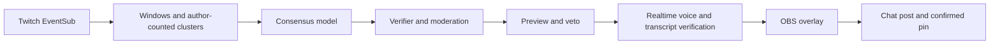

# Spokesmob

Your chat, one voice. Spokesmob turns Twitch chat into a spoken summary that only says what many chatters agree on. The vote count stays on screen with a softer dissent whisper, and the streamer sees every line in a private preview with a Veto before anyone hears it. It brings a busy room together and gives a chat of three to five people something they can shape together.

## Try it free in 2 minutes

Install Node 24, then run these from the repository:

```powershell
npm install
npm run demo
```

No keys or Twitch account required. The repeating showcase opens the overlay and dock in your browser, using synthetic chat and a locally generated simulated voice. Click **Click to enable sound** if the browser asks. Both views label the simulation. Use `npm run demo -- --no-open` to keep browser opening off. Press Ctrl+C in the terminal to stop.

## What you can try

- Consensus lines with agreement counted from distinct authors, plus a quieter dissent voice.
- Question rounds, automatic split-decision votes and streamer-started chat votes. Type `!mob vote Gary | Milo` as broadcaster/moderator, or use the dock's **Start vote** form.
- Laugh-triggered clips and independent stream markers, with support scaled for small chats.
- Small-chat support: two laughers in a small room, a 2-2 split and two-voter results when the configured minimum permits.
- Raid and Hype Train reactions, live mood, captions and chatter-name particles.
- Wide, compact and stage layouts; stage includes a QR that takes viewers to the channel.
- An OBS dock with the private preview, Veto, Mute and Kill. Every spoken unit keeps its preview hold.

## Safety in plain words

Raw chat is never read aloud. Only verified summaries and safe templates can reach audio. Input exemplars and ballots receive individual moderation results, and generated output is moderated too. A deterministic verifier checks support, wording, the blocklist and usernames. Chatter usernames are never spoken; raid templates may name the incoming channel. Preview and Veto apply before every spoken unit, and Mute/Kill cancel audio within 200 ms. Recorded paid evals passed all 20/20 prompt-injection safety samples (100%); the offline harness checks wiring without making model-quality claims.

## How it works



Voice also passes usable-audio checks before PCM leaves the server. Main and dissent form one spoken unit; a failed or cancelled unit cannot post as spoken. A split/vote prompt hides the agreement meter, then the live vote plate and verified result show their own counts.

## Live setup in under 10 minutes

Bring **Node 24 (24.15+)**, npm, **OBS 33**, an OpenAI project API key and a Confidential Twitch app with its client ID and secret. The free demo only needs Node and a browser. Twitch sign-in uses the broadcaster account; no Twitch Polls are needed for chat voting.

1. Run `npm install`. Copy `.env.example` to `.env` and fill the Twitch app credentials, channel login and OpenAI key yourself. Keep credentials private. Choose a spend cap before a live run; the default is USD 5 per stream.
2. Run `npm run setup`, complete Twitch activation and approve the listed permissions. For captures, enable **Clips** and **Store past broadcasts** in Twitch Creator Dashboard's Stream settings.
3. Run `npm run build`, then `npm start`. A live channel plus an active audio client enables paid consensus/voice calls; the dock holds the loop for offline, muted, killed or capped states.
4. In another terminal, run `npm run voice -- --copy-url`. Paste into exactly one OBS Browser source at **1920 x 1080**, enable **Control audio via OBS**, clear **Custom CSS**, and turn off source shutdown/refresh on scene changes.
5. In OBS Advanced Audio Properties, leave the source unmuted and check Audio Monitoring **Enable**. Choose headphones as the Monitoring Device and disable Desktop Audio when it captures that same device.
6. Run `npm run voice -- --copy-url control` and add the copied address as an OBS Custom Browser Dock. Choose the layout and check the cap, minimum voices and Auto/On-demand mode there.
7. Make a short OBS recording and run `npm run voice -- --tone`. Confirm exactly one beep in headphones and the recording. Ask a question, then let chat answer; keep Veto, Mute and Kill within reach.

The [OBS audio setup](#obs-audio-setup) below has the full routing and troubleshooting instructions. Private overlay/dock addresses are copied without printing their tokens.

### Measured running cost

A measured three-minute mock-Twitch run with real consensus and voice cost about **USD 0.032** for 21 spoken beats, including 11 dissent beats: approximately **USD 0.64/hour at that cadence**. Its end-to-end latency was p50 **2.65 s**, p95 **2.95 s**. Cost varies with cadence, line length, dissent and retries. The free demo costs **USD 0** in API calls, and the dock enforces the configured spend cap.

## Twitch integrations actually used

All realtime ingest uses EventSub WebSocket. These are the requested subscriptions; poll/reward notifications are ingested without creating native Twitch Polls or rewards:

| EventSub subscription | Version |
| --- | --- |
| `channel.chat.message` | 1 |
| `channel.chat.notification` | 1 |
| `channel.chat.message_delete` | 1 |
| `channel.chat.clear_user_messages` | 1 |
| `channel.chat.clear` | 1 |
| `channel.raid` (incoming) | 1 |
| `channel.hype_train.begin` | 2 |
| `channel.hype_train.progress` | 2 |
| `channel.hype_train.end` | 2 |
| `stream.online` | 1 |
| `stream.offline` | 1 |
| `channel.poll.end` | 1 |
| `channel.channel_points_custom_reward_redemption.add` | 1 |

Helix calls used by the runtime and live-check tools all share the rate limiter:

| Method and endpoint | Use |
| --- | --- |
| `GET /helix/users` | Resolve the broadcaster identity |
| `GET /helix/streams` | Confirm whether the channel is live |
| `GET`, `POST`, `DELETE /helix/eventsub/subscriptions` | Manage WebSocket subscriptions |
| `POST /helix/chat/messages` | Verified posts and command acknowledgments |
| `GET`, `PUT`, `DELETE /helix/chat/pins` | Read, create and remove confirmed-message pins |
| `POST /helix/chat/announcements` | Questions and chat-vote invitations |
| `GET /helix/moderation/blocked_terms` | Refresh channel-specific speech protection |
| `POST /helix/clips` | Request a 30-second laugh clip |
| `GET /helix/clips` | Confirm clip creation |
| `POST /helix/streams/markers` | Mark the moment independently of clipping |

Ballots arrive through `channel.chat.message`, with one latest eligible choice per author. Chat votes use messages and announcements, not the Twitch Polls API. Chat sends and announcements are never retried; a pin requires a confirmed send without a drop reason.

Vote displays restore after a reconnect or refresh. Question changes, clears and removed ballots cancel a pending result, including queued output. Diagnostic voice checks stay unavailable until the vote and its result settle.
Votes and live chat windows use receipt time; Twitch timestamps order ballots and moderator clears, so PC clock skew does not shorten voting or exclude fresh chat.

## Built with Codex

[AGENTS.md](AGENTS.md) keeps the architecture, privacy and safety rules next to the code. The [eventsub-subscription](.agents/skills/eventsub-subscription/SKILL.md), [helix-call](.agents/skills/helix-call/SKILL.md) and [golden-window](.agents/skills/golden-window/SKILL.md) skills guide repeatable additions with mocks and replay coverage. The Stop hook runs `npm test` before a turn finishes. Codex built the [eval harness](eval/README.md), iterated prompts against reviewed synthetic windows, and used its results to select wording and service tier without lowering verifier thresholds. Codex cloud produced three face attempts; a best-of-3 comparison selected Round Ink. Code review and the unit, browser and hygiene checks precede releases.

## Development

Requires Node.js 24.15 or newer and npm. Storage uses Node's built-in SQLite.

```powershell
npm install
npm run typecheck
npm test
npm run lint
```

The workspace contains the server, overlay, control page, shared logic, development tools, and evaluation runner. The Twitch listener, automatic beat loop, authenticated controls and overlay audio checks are available.

The [shared beat and overlay contracts](packages/core/README.md) define cycle steps, settings, client roles and message schemas for the loop and control integration.

Run `npm run setup` to sign in to Twitch. Open the activation URL printed by the command, enter its human activation code, and approve the requested permissions. Running setup again reuses valid authorization. The broadcaster account is recommended; moderator authorization is unverified.

Tokens are saved atomically outside the repository: `%LOCALAPPDATA%\Spokesmob\tokens.json` on Windows, or `~/.config/spokesmob/tokens.json` elsewhere. To sign out, stop the application and delete that file (or the file selected by `TOKEN_FILE`). Keep the file private.

After setup, `npm start` listens to Twitch events, serves the overlay locally and runs the beat when the stream is live and an active audio source is connected. One server instance holds a lock beside the token file. It requests chat, chat notices, incoming raids, Hype Train, stream status, poll results and reward redemptions. Reconnects preserve subscriptions when Twitch supplies a handover URL; dropped connections create a fresh session and subscriptions.

Chat collection continues while a beat is being verified or spoken. The next window opens atomically when the previous one closes; underfilled windows keep a rolling 30 s view. The verified line and dissent prepare together during preview, then play in order. Veto, mute, kill or a lost safety condition cancels both takes and prevents output. After the whole spoken unit ends, the loop posts once and pins only a confirmed send, then cools down. Main caption-only, suppressed and vetoed units are not posted. Quiet mode posts after its preview plus 3 s of caption reading without generating voice. Event templates never post a second chat notice.

Settings, mute/kill, gags, beat records and per-call cost reservations use local SQLite beside the token file. Timed mute survives restart until its saved expiry; kill persists until explicit unmute. History cleanup does not reset the active session's spend accounting. Raising the cap can release a capped loop; missing usage keeps its reservation.

The beat log retains outcomes, gate/reason, selected and rejected wording, available cost and latency stages. History defaults to seven days, with cleanup at startup and hourly. Cancelled requests with unavailable cost remain unknown. A lost live/audio gate, moderator deletion, veto, mute, kill or shutdown can cancel in-flight work; a provisional moderation request cancelled at a window handoff is replaced for an active synthesis caller.

EventSub also provides typed message deletions, user-message clears and full chat clears through the existing chat-read authorization. Use `npm run mock -- moderator-actions` to replay these actions locally.

Speech protection combines a built-in profanity matcher, encoded harassment terms and the channel's Twitch blocked terms. Channel terms load at startup and refresh every ten minutes; a failed refresh keeps the last good protection and logs a warning.

Completed polls arrive as `pollEnd` events with the poll title, status and each choice's vote total. They use the existing poll permission requested during setup.

Check authorization with `npm run twitch:check -- --status`, or capture typed events with `npm run twitch:check -- --listen 120`. Wait for "Capture active" before sending plain text, an emote, an @mention and a reply from another account. Output includes subscription timing, fragment types, `self` and `replyToId`.

`npm run twitch:check -- --write` posts one check message, immediately proves local duplicate suppression, pins the confirmed message with a 60-second duration, reads it back, waits about a minute, explicitly unpins it and sends a purple announcement. Keep chat visible while it runs. A failed or uncertain send is never pinned or retried.

Twitch writes use a shared rate limiter. Chat messages and announcements never retry automatically, and identical chat messages are suppressed locally for 30 seconds. Pinning is a separate request after a confirmed send with no drop reason. An empty send result is treated as not sent and is never pinned or retried.

The typed [Get Streams](https://dev.twitch.tv/docs/api/reference/#get-streams) read queries the resolved broadcaster by `user_id` through the general-rate guard, without extra permissions. Empty results and entries without `type: "live"` do not establish online status; malformed or mismatched responses fail closed. The mock supports live/offline state with the same response contract.

## Commands and local API

Run `npm run build` before starting the server. Copy the dock URL with `npm run voice -- --copy-url control`, then paste it into OBS **Docks → Custom Browser Docks**. Keep its token private. The [control dock guide](apps/control/README.md) covers its layout, shortcuts, resync and log export. The same page works in a browser.

The dock shows step and blocking conditions, mode, question, health, cost, latency and beat history. Veto cancels either take; Mute and Kill stop both. Focus the dock to use V, S, M, K and U for Veto, Speak now, Mute, Kill and Unmute. Editing a field suppresses shortcuts. **Test while offline** is a visible, session-only exception to the live-stream gate and resets at restart.

The mode button **Captions only** runs without voice and uses `quiet` in chat commands and the API. Mute holds until its timer expires or Unmute is pressed; Kill holds until explicit Unmute.

The layout selector changes the shared overlay layout. A valid explicit `layout` query parameter pins that browser source instead. Ordinary control tabs never claim audio ownership.

For an offline channel check, note the current session cap and select On-demand. In Settings, save a small cap and minimum voices of 1 before enabling **Test while offline**. Use an ordinary alt account for consensus samples; the broadcaster's own messages are excluded from consensus agreement but can be ballots in chat votes. Each Speak now starts a paid beat. Finish with explicit Unmute to clear any persisted Kill, Turn off, disable the test switch, restore minimum voices to 2 and the original cap, then restore Auto and save. The mock stores settings separately, so configure the real server too.

Only the broadcaster badge or moderator badge authorizes chat commands, including the broadcaster's own messages. Other accounts are ignored silently. Commands never count as votes.

| Command | Action |
| --- | --- |
| `!mob on` / `!mob off` | Resume or pause beats; off does not post a muted message |
| `!mob mode auto\|demand\|quiet` | Change the saved mode |
| `!mob speak` / `!mob veto` | Close an On-demand window or cancel the current spoken unit |
| `!mob mute [minutes]` | Mute for 1?60 minutes, defaulting to 5 |
| `!mob unmute` / `!mob kill` | Clear a mute or kill until explicit unmute |
| `!mob gag @user` / `!mob ungag @user` | Exclude or restore a user resolved from Twitch's mention fragment |
| `!mob vote A \| B` | Start a verified 30-second vote with two safe labels |
| `!ask <question>` / `!mob clear` | Set a moderated question of at most 100 characters, or clear it |

State changes acknowledge once through the chat guard. Identical acknowledgments within 30 seconds can be suppressed. Gag acknowledgments never repeat the name. Questions reject URLs and mentions, pass the blocklist and per-item moderation, then announce in purple. Clear removes the question without a chat acknowledgment and cancels a pending question change too.

HTTP controls use the same handlers: `POST /api/on`, `off`, `speak`, `veto`, `mute`, `unmute`, `kill`, `mode`, `question`, `clear` and `settings`. Bodies are strict JSON: empty `{}` for simple actions, `{"minutes":5}`, `{"mode":"demand"}`, `{"question":"Name my cat"}` or `{"changes":{"holdMs":1000}}`. Send the local token through `Authorization: Bearer <token>` or the token query parameter; never publish a credential-bearing URL. POST requires the local Origin, and all requests require the local Host. Foreign origins are rejected.

`GET /api/state` returns `{state,settings}`. `GET /api/log?limit=200` returns newest-first records with cited names omitted. Add `names=1` to include them, and `before=<last-row-id>` for the next page. Request and error logs omit URLs and credentials.

WebSocket clients declare one immutable role in hello. Only control clients may send commands or voice checks. They receive state, health, cost and log updates with no audio. Overlays receive visuals and verified audio, with playback reports accepted only from the current audio owner.

External GET hotkey actions are reserved for a later release. Their reserved URL format is `http://127.0.0.1:4040/api/hotkey/<action>?token=<token>`, with `veto`, `speak`, `mute` or `kill` as the action; these URLs are not served in this version. Use the focused dock shortcuts or the authenticated POST controls above.

## Local Twitch mock

`npm run loop -- --mock name-my-cat` starts the complete local loop, including mock Twitch authorization, EventSub and Helix. It shares the local overlay token and port with the normal server, so stop that server first. Mock Twitch credentials stay synthetic and never replace your saved Twitch token. Settings and history use a separate `mock-spokesmob.db` beside the token file.

Open the OBS overlay and the control dock to release the audio-client gate. By default the consensus model is a stub and voice playback is simulated without PCM. Log rows say **Simulated**; their timing does not measure a model or real audio. The terminal shows mock send and pin requests without message content. Veto, mute, kill and all other gates still run.

Add `--minutes 3 --report` for a finite run with outcome counts, window-processing p50/p95/max, latency stages, heap samples and cost. Stages overlap: voice preparation runs during the preview hold, so stage percentiles must not be added. `--headless` supplies a simulated client only when both providers are stubs; paid flags reject it. `--port 0` selects a temporary port for unattended local checks.

`npm run loop -- --mock crowd --authors 300 --rate 60 --minutes 5 --report` runs the full load check outside the unit-test suite. A five-minute crowd uses 18,000 synthetic messages. Window-processing measurements include assembly and clustering during premoderation and synthesis; listening-only assembly is reported separately. Every begun beat must resolve or remain explicitly pending, and cancelled or suppressed outcomes are counted separately from dropped beats. Heap samples include garbage-collection variation.

`--live-model` and `--live-voice` opt into paid OpenAI calls while Twitch stays mocked. Approve the displayed projection before adding `--yes`; `--max-cost-usd` sets a fixed run ceiling (default USD 0.10) that panel settings cannot raise. All paid calls retain reservations and unknown usage. A real API failure stops the mock run and reports it. Real end-to-end timing requires `--live-voice` and the active OBS audio owner's playback report. The default mock is free.

`npm run mock -- name-my-cat` starts a local EventSub, Helix and authorization server. Other scenarios include `raid-arrival`, `hype-train`, `reconnect-midstream`, `keepalive-silence`, `revocation`, `notices` and `poll-and-redemption`. Use `--speed 5` (up to 20), `--loop`, or `--port 8081` as needed. A JSONL file path also works.

Archived replay leaves the file untouched. The mock skips recorded session controls, adapts subscription and session IDs, and rebases envelope timestamps while preserving event spacing at the selected speed. Event content and first-pass message IDs stay unchanged; later loops get unique envelope IDs. Use `--literal-timestamps` to preserve archived timestamps and exercise stale-frame rejection.

Use the three URL overrides printed by the mock, client ID `mock-client`, any synthetic client secret and channel `spokesmob_demo`. Select a separate token file with `TOKEN_FILE` and run setup against those overrides. Mock authorization completes automatically; never send real credentials to the mock. Clear the overrides before reconnecting to Twitch.

Generate a larger synthetic conversation with `npm run sim -- --authors 300 --rate 60 --seconds 60 --clusters "gary:0.4,pickles:0.2,noise:0.4" --out crowd.jsonl`, then replay it with `npm run mock -- crowd.jsonl --speed 20`. `--seed` makes output reproducible; `--repeat-share`, `--typo-share`, `--case-share` and `--emote-share` control variation.

For labeled conversations, give each cluster its own phrases: `--clusters "gary=gary|name him gary:0.5,cat=猫|gato:0.5"`. `--spec <file.json>` loads the same generator settings from JSON; explicit command options override the file. Generated chat rows carry a ground-truth label for offline quality checks, which the mock omits from Twitch payloads.

## How a line is chosen

Messages are normalized into text and emote signals. Self messages, commands and excluded or moderator-deleted messages do not count. Repeated messages from one person never create extra votes. Emote-only participants still count toward the window's voice total and mood.

Similar messages form clusters, with negations kept apart. The server moderates each selected exemplar separately while the window fills, caches those results, removes flagged buckets and rebuilds the counts. Severe flags or unavailable moderation suppress the window. Channel blocked terms add to the built-in blocklist.

OpenAI receives the active question, voice total, mood signals and up to twelve clusters containing author counts, shares and short exemplars. It receives no author names or IDs. Chat strings remain untrusted data inside a marked JSON envelope. The model proposes a short line, citations and optional dissent; the application computes agreement from the cited author sets.

The immediately previous verified line is supplied as the mob's own prior output to avoid repeated phrasing. It supplies no votes or evidence for the new window. The near-duplicate verifier and single regeneration attempt still apply.

Each model response also includes an alternate wording with the same citations. When the main line fails only for repeating the previous line, the alternate passes the full verifier before selection. The selected text is used for captions, voice and the chat post. Both candidates share the existing inline output-moderation result; no additional moderation call is needed. Beat records retain rejected candidate text and failure codes, encoding blocked text.

When every cluster has a share below 0.20, the prompt can name up to three cited options using source wording. When at least two clusters each have a share of 0.25 or more, it cites only the largest one, breaking ties either way, and puts the next-largest one in dissent. It never adds opposing sides together as the main agreement in that case.

The verifier checks support, wording, length, blocked terms, contact patterns, usernames and output moderation before a line is accepted. A rejected generation can be rewritten once. A transport failure or two rejected generations can use a separately moderated, verified fallback; otherwise the window is suppressed with a reason. Consensus commands print results without speaking or posting them.

Fast is the selected model tier. In a paired local comparison, model-call p95 was 1.639 s on fast versus 6.007 s on default, with zero versus eight timeouts. After the share-rule prompt fix, the full fast evaluation passed all 100 quality and latency checks; p95 was 1.217 s and mean model cost was about USD 0.000114 per call. These are recorded measurements, not fixed response-time guarantees.

## Configuration

`npm run consensus -- name-my-cat` checks recorded scenario input locally. A JSONL path or a golden JSON file also works; `--window 8` sets scenario window length and `--question "Name the cat?"` supplies context. Offline output is unmoderated, uses a deterministic stub and is not for streaming.

`--live` uses the OpenAI consensus pipeline and costs money. Run it manually after reviewing the expected call count. It prints verified lines or suppression reasons, author-counted percentages, dissent, mood, per-stage latency and available cost. `--tier fast` overrides the configured tier. Nothing is spoken or posted. `npm run consensus -- --count-prefix` uses the API token counter and prints the static prefix token count and SHA-256; run it only as an approved API check.

`npm run eval -- --offline` checks the evaluation harness without API calls. For a paid run, first review `npm run eval -- --plan` and approve its projected cost and call count. The [evaluation guide](eval/README.md) describes the reviewed golden windows, assertions, reports and separate tier comparison.

`npm run eval -- --compare-tiers --n 5 --max-cost-usd 0.10 --plan` projects a paired default/fast evaluation of all windows. Remove `--plan` only after approval within the displayed cost limit. Comparison samples alternate default then fast with one worker. Reports separate quality from latency and show each tier's p50/p95/max, timeouts and available cost; `--baseline eval/reports/<report>.json` checks category quality against an earlier completed run.

The conservative preflight is the default. Use `--preflight expected` only with explicit approval to admit a run using its expected cached-cost projection; the selected runtime limit and conservative per-request reservations still apply.

Copy `.env.example` to `.env` and fill in your credentials locally. Keep credentials out of source control.

| Variable | Purpose |
| --- | --- |
| `TWITCH_CLIENT_ID` | Twitch application client ID |
| `TWITCH_CLIENT_SECRET` | Twitch application client secret |
| `TWITCH_CHANNEL` | Broadcaster login, in lowercase |
| `TWITCH_BOT_LOGIN` | Optional separate bot login |
| `OPENAI_API_KEY` | OpenAI project API key; required for the automatic loop and commands that call OpenAI |
| `CONSENSUS_SERVICE_TIER` | `fast` (selected default); `default` is available as an explicit override |
| `MIN_VOICES` | Minimum distinct authors for a line; integer from 1 to 10, defaults to `2` |
| `BEAT_MODE` | Initial mode: `auto`, `demand` or `quiet`; defaults to `auto` |
| `WINDOW_S` | Initial collection window, `5`–`20` seconds; defaults to `8`, adapts up to `30` |
| `HOLD_MS` | Preview hold, `500`–`3000` milliseconds; defaults to `1000` |
| `COOLDOWN_S` | Delay after the spoken unit and output settle, `0`–`10` seconds; defaults to `2` |
| `PIN_S` | Confirmed-post pin duration, `30`–`1800` seconds; defaults to `60` |
| `POST_LINES` | `every` (default) or `off`; saved control settings override these environment seeds |
| `MUTE_DEFAULT_MIN` | Default timed mute, `1`–`60` minutes; defaults to `5` |
| `VOICE_PROVIDER` | `realtime`; legacy is unavailable in this version |
| `MAIN_VOICE` | Main voice; defaults to `cedar` |
| `WHISPER_VOICE` | Dissent voice; defaults to `sage` |
| `OPENAI_REALTIME_URL` | Development and tests only: loopback mock WebSocket; leave unset for OpenAI |
| `PORT` | Local HTTP port; defaults to `4040` |
| `EVENTSUB_URL` | EventSub WebSocket URL; override for local development |
| `HELIX_URL` | Development or testing only, leave unset; defaults to Twitch Helix |
| `TWITCH_AUTH_URL` | Development or testing only, leave unset; defaults to Twitch OAuth |
| `TOKEN_FILE` | Development or testing only, leave unset; overrides the local token file |
| `RECORDINGS_DIR` | Local chat recording folder; defaults beside the token file; keep it outside the repository |
| `DB_FILE` | SQLite settings, gags, beat history and cost ledger; defaults to `spokesmob.db` beside the token file, outside the repository |
| `LOG_RETENTION_DAYS` | Beat and cost history retention, from `0` to `30` days; defaults to `7`; cleanup runs at startup and hourly |
| `SPEND_CAP_USD` | Per-stream spend cap; defaults to `5` USD |
| `LOG_LEVEL` | Structured log verbosity; defaults to `info` |

## Overlay visuals

The Round Ink face follows verified audio, with a softer dissent pose, live mood and Hype Train accents. Captions appear when playback starts, or after the preview hold for a verified caption-only line. The dock shows the private preview and a countdown with Veto. Pending text never appears on the stream.

Wide keeps the face and name particles near the lower-left; stage adds a large listening counter and a QR to your channel; compact uses a bottom bar. Agreement includes the voice count, dissent includes its own percentage, and the separate counter hides while agreement is displayed. Every layout shows the AI voice badge. The source follows the dock's layout selector unless its URL explicitly pins a layout.

The [overlay guide](apps/overlay/README.md) covers the rig, text, layouts and synthetic scene harness. Run `npx playwright install chromium` once, then `npm run test:e2e` for browser checks and ignored scene screenshots. This suite also starts an isolated mock loop and plays a free verified tone; it does not use your credentials or call paid models. Unit and replay tests remain in `npm test`.

## OBS audio setup

Run `npm run build`, then `npm start` and leave the server running. Startup saves the complete overlay URL beside the local token file and prints only its file path. In another terminal, run `npm run voice -- --copy-url` to copy the URL without displaying its token.

In OBS 33, add exactly one Spokesmob Browser source. Paste the copied URL, use 1920 × 1080, and enable **Control audio via OBS**. Turn off **Shutdown source when not visible** and **Refresh browser when scene becomes active**. Remove leftover Spokesmob browser sources: a hidden source keeps running and can take over audio. Clear the source's **Custom CSS** box completely. The overlay already has a transparent background; OBS's default injected CSS is blocked by its strict content security policy and otherwise logs a harmless console error.

In **Advanced Audio Properties**, check Audio Monitoring **Enable**, keep the source unmuted and select your recording track. In **Settings → Audio → Advanced**, select your headphones as the monitoring device. Set **Desktop Audio** to **Disabled** when it captures the monitoring device. Leaving that capture enabled can cause doubled audio or OBS audio deduplication to drop the overlay from the output.

Start a short recording and run `npm run voice -- --tone`. It generates a free one-second beep through the same take, socket and audio-player path. Confirm the headphones, source meter and recording each have one clean beep. A regular Chrome tab with the same URL shows **preview, silent** and produces no audio. Audio is enabled only in OBS or with an explicit `audio=1` URL setting; keep just one audio-playing client.

After a server restart, the overlay and control panel reconnect automatically with a retry delay capped at five seconds. Keep the browser source active while it reconnects.

Before enabling the beat, startup retrieves model metadata over the HTTP connection and connects/configures both voice sessions. This warm-up submits no prompt, audio input or response-generation request and consumes no model tokens. A failed warm-up logs a warning and leaves the server and controls running; the first beat can connect on demand. The first actual generation still performs model and prompt-cache work. Free mock runs keep using stubs.

Spokesmob uses an **AI-generated voice**. Disclose that to viewers. Dissent is a different voice spoken normally, made softer by the overlay mixer; the model is never prompted to whisper. Generation is held on the server until transcript and raw-audio checks pass, then edge silence is trimmed before playback. A failed retry becomes caption-only; legacy is unavailable and is never called automatically.

`npm run voice -- --say "A lot of chat says pink, red or orange." --yes`, `--kill-test --yes`, and `--calibrate 40 --yes` make paid calls and require approval of their projection. Calibration defaults to verified synthetic lines, reports metrics and rejected transcripts locally, and saves no audio. Calibration reserves a capped attempt's estimated cost before dispatch; `--max-cost-usd` sets its runtime budget, defaulting to USD 0.10. Missing usage keeps that reservation and an unknown cost. Its usable-audio gates run on untrimmed PCM; overlay gain and filters cannot change acceptance. Numeric thresholds are changed only after reviewing new validated evidence.

To check dissent, run `npm run voice -- --say "Some of chat still says blue." --dissent --yes`. Record the main line, kill test and dissent in OBS: speech should play once, the kill test should stop within 200 ms, and dissent should be softer but intelligible. CLI results include verified-ready time, playback start, trim metrics and the kill test's `silenceMs`.

In a 40-line calibration, all lines verified with one discarded transcript mismatch and retry, no usable-audio rejection and mean cost USD 0.000985 per line. First audio was p50/p95 336/481 ms, complete generation 491/689 ms, and verified-ready 496/767 ms. A separate live check after restart had first audio at 927 ms, verified-ready at 1,189 ms and playback at 1,295 ms; a subsequent line reached first audio at 428 ms. The audible kill check stopped in 1 ms according to the overlay report. These are observed timings; check the first line after restart during rehearsal.

### Troubleshooting

**Monitoring device unavailable at startup.** If OBS starts before the headphones are available, overlay monitoring can fail silently with "Failed to activate device" in the OBS log. Connect the headphones, choose them under **Settings → Audio → Advanced → Monitoring Device**, then restart OBS. Changing the device after startup does not repair the failed monitor. If Desktop Audio captures that same device, set **Desktop Audio** to **Disabled** so OBS audio deduplication does not drop the overlay from the stream or recording.

**Windows console selection pauses the server.** Clicking inside the console running Spokesmob can start a QuickEdit selection and pause the process until **Esc** or **Enter** clears it. Avoid clicking in that window while live, or open the console's **Properties → Options** and turn off **QuickEdit Mode**.

## Local recordings

`npm run record -- --minutes 2` records raw Twitch frames. `--out <file>` selects a new output file. Recordings stay local; startup lists and deletes JSONL recordings older than seven days from the configured recording folder. Source folders that are public in Git cannot hold raw recordings.

Use `npm run record -- --anonymize <input> <output> --replace-text` to create a fixture with deterministic fake identities and synthetic chat text. Without `--replace-text`, message text remains and requires each author's consent before publication. Anonymization removes reply bodies, colors and emote owner IDs. Output files must be new; existing files are not overwritten.

Public badge categories and emote identifiers are preserved so replay retains their meaning.

### Free demo

Run `npm run demo` for a repeating synthetic chat showcase. It builds missing browser assets, opens the overlay with sound and the dock in your default browser, and keeps the usual local token location so an existing OBS source can connect. Use `npm run demo -- --no-open` to keep the browsers closed. This command never loads `.env`, strips application credentials from its child environment and rejects paid flags. The voice is a local speech-shaped tone, not speech or a model call; both views label it "Demo · simulated voice". Click "Click to enable sound" if a normal browser blocks autoplay. OBS never shows that button. Headless mock load tests retain simulated playback reports.

### Laugh-triggered capture

Auto-clip is on by default and can be switched off in the dock settings. For ten seconds after a shown line finishes, between two and four distinct laugh authors, scaled as 40% of distinct trailing-minute chatters rounded up, or at least six non-ballot messages from three authors over at least five seconds at a chat rate of at least three times the previous minute (and at least one message per second) can request a 30-second clip and an independent stream marker. Capture requires an online stream, allows one clip per line, and has a three-minute cooldown. Clip titles use a conservative local 100-character word-boundary cap. A title rejected by AutoMod gets exactly one title-free request; other create failures are not retried. Confirmation polls every five seconds for up to one minute. The dock logs the confirmed link and readable failures; the overlay shows a three-second Clipped badge. Capture never posts to chat.

In Twitch Creator Dashboard, open Settings > Stream, enable Clips, and turn on Store past broadcasts for stream markers. Restricted clips, an offline stream or unavailable VODs appear in the dock log. The Twitch integrations include Create Clip, Get Clips and Create Stream Marker through the shared Helix limiter, using the existing scopes.

### Split-decision votes

Split votes is on by default in the dock settings. With an active question, a close split between two clusters can ask chat to choose without Twitch Polls or additional scopes. Each side needs `max(minimum voices, clamp(ceil(0.25 * window voices), 2, 3))` distinct authors. Together the sides must cover at least half the window, and their shares must be within ten percentage points. Display and spoken labels use title case; ballot matching stays folded. Labels come from the shortest normalized exemplars, with at most four words and 25 characters, and pass input moderation, the blocklist and text hygiene.

The verified split prompt gets the normal preview and Veto. After the unit finishes, a single announcement opens a 30-second vote, with no regular post or pin for that prompt. Type exactly 1, 2 or an option label; each author's latest eligible choice counts, including the broadcaster. Ballots never enter consensus collection. Deleted ballots and cleared users lose their votes; excluded, gagged and moderation-flagged messages cannot vote. Collection continues while other speech waits. Mute, Kill, chat clear, Clear question or going offline cancels without a result. The overlay shows the choices, distinct-voter bars and countdown; the dock logs counts and the outcome. When the trailing minute has six or fewer eligible chatters, at least max(2, minimum voices) voters produce a computed winner or tie; larger rooms require three. Fewer produce "Not enough votes to call it." The result is verified, previewed and vetoable, then posts and pins normally. A question gets at most one vote attempt, with a five-minute cooldown between opened votes. Chat messages and guarded announcements provide the entire integration.

### Streamer-started votes and small chats

Broadcasters and moderators can type `!mob vote Gary | Milo`, or use the dock's two-field Start vote form. Labels are title-cased, must contain at most four words and 25 characters, and pass the same blocklist, username/hygiene, input moderation and template verification as automatic split labels. Invalid requests produce a readable dock error or guarded chat acknowledgment. Command messages never become ballots or consensus votes.

A manual vote works with or without a question and skips automatic split cooldown and question-attempt limits. It can be explicitly requested even when automatic Split votes is switched off. Wait for the current unit, cooldown or vote to finish before starting another. The prompt uses the same preview, veto, safety gates and voice checks; its announcement, ballots, cancellation and verified result follow the normal chat-vote path. Neither automatic nor manual vote prompts post or pin. A four-person room can trigger an automatic 2-2 split, and a small room can call a result with two voters when the configured minimum allows it.
