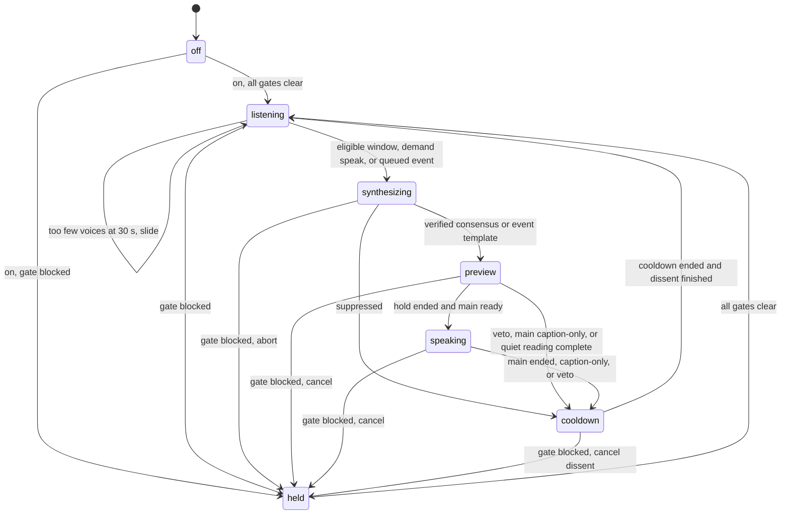

# Shared beat contracts

[beat-types.ts](src/beat-types.ts) defines the beat state, events, effects and declared transitions. [overlay-protocol.ts](src/overlay-protocol.ts) defines the JSON schemas for both WebSocket directions and each client role. [beat-settings.ts](src/beat-settings.ts) defines validated settings and their defaults. These modules perform no I/O and read no clock. The reducer receives time as an argument; timers are effects carrying an ID and deadline.

## Cycle

The current point in the cycle is always named `step`, with these values:

`off` is accepted from every other step and cancels work. Mute and kill abort synthesis, cancel both takes, unpin and acknowledge the muted state. Blocking reasons are `muted`, `killed`, `off`, `offline`, `capped`, `no_audio_client` and `overlay_inactive`; more than one may apply. Quiet mode needs a connected overlay but no audio client. The offline test switch belongs to session state, never persisted settings.

Collection continues in every step except `off`. Closing a window carries its replacement in the same effect so the collector can roll without a gap. Auto closes eligible windows after the configured duration; demand uses a rolling 30 s view and closes only on Speak now. Quiet holds the caption for the preview plus 3 s and never prepares or plays audio.

Preview prepares main and dissent together. Main plays after verification and the hold; dissent follows main playback. The outcome and cooldown deadline are established when main ends. Posting runs independently, and a new beat waits for any dissent to finish. Timer IDs, beat IDs and channel/take IDs identify late callbacks. Verified event templates use the next free slot and are never posted.

## WebSocket contract

All JSON messages have a `type` discriminator. `state` carries `step`, `mode`, `muted`, `mutedUntil`, `online`, `testOffline`, `capped`, `heldBy`, `question` and `layout`. A server `hello` carries `role`, `audio` and the same snapshot as `state` without its discriminator. Layouts are `wide`, `stage` and `compact`.

Overlay clients declare `hello{role:"overlay",audio,obs}` and can report `active`, `started`, `played`, `ended` and `stopped`. Control clients declare `hello{role:"control"}` and can send `command{request,command}` or the existing `voice_command`. Control replies always have `audio:false`. The role-specific schemas describe the authorization boundary; runtime role enforcement belongs to the server's command integration.

Server messages to the overlay are `hello`, `state`, `listening{voices,messages,windowMs}`, `particles{names}`, `particles_clear`, `line`, `veto{take}`, `event`, and the existing audio controls. `line` includes take, text, computed percent/voice count, dissent, mood, question, answersQuestion, templated, citedNames, holdMs and quiet. A flat `event` uses `kind` for its subtype: raid carries name/viewers, while hype_begin/hype_level/hype_end carry level/shared. The outer `type` remains `event`.

Only control clients receive `log{row}`, `cost{usdSession,usdHour,cap}`, `health`, command `result`, and `voice_result`. Health covers Twitch auth, EventSub, subscription counts, both realtime sessions, audio ownership/activity and latest e2e time. Unknown latency or cost stays null. Log voice-attempt metrics serialize negative-infinite dBFS as `"-Infinity"`; no PCM is permitted in these JSON records.

Particle names and cited names must be filtered before emission. Every deletion or clear sends `particles_clear`. Schemas validate shape; they do not replace the blocklist, moderation, author counting or text verifier.

The unchanged audio messages are `prepare{take,channel,text}`, `play{take,durationMs}` and `stop{take|"all"}`. Binary audio keeps its 9-byte header: channel byte (0 main, 1 dissent), unsigned 32-bit big-endian take and chunk sequence, then signed 16-bit little-endian PCM at 24 kHz. Only the current active audio owner receives PCM. No unverified audio may be sent.

New visual/state/control contracts are defined here for integration; the existing audio path already imports the shared audio schemas. The running audio handshake remains compatible until the server and clients adopt the role contracts together.
